# Documentation Sprint 2

Fitness Franchise - Espace adhérent et suivi des entraînements  
État du code au 30 octobre 2026 - Guide de lancement, d'utilisation et de validation

**Édition illustrée.** Seize captures réelles de l'interface actuelle sont réunies dans le parcours illustré en fin de document. Les écrans personnels utilisent un compte fictif dédié : cinq séances totalisant 150 minutes et 16,7 km. Les images de catalogue portent explicitement sur l'aperçu fictif. Aucune donnée d'un compte existant n'a été modifiée. L'illustration de couverture est un visuel du projet, pas une capture d'écran.

## 1. Objectif et bilan du sprint

Le Sprint 2 construit un espace personnel permettant à un adhérent de recevoir ses séances simulées, consulter son historique filtré et suivre son activité à travers des totaux et un graphique hebdomadaire. L'objectif de fréquence hebdomadaire, prévu en Should Have, est également implémenté.

L'équipe réunit Taleb Wissame (backend et coordination), Taleb Lamia (base de données et simulateur) et Meriem Takdjerad (interface). Les travaux ont été intégrés depuis la branche main, notamment les commits frontend, simulateur et schéma SQL jusqu'à 0a07be8. Les modifications locales ultérieures complètent le backend et le raccordement React ; elles ne sont pas assimilées à des commits déjà publiés.

| Domaine | Réalisation présente dans le code | État de validation |
|---|---|---|
| W01 / M01 | Inscription, connexion, déconnexion, profil minimal | Backend testé ; React raccordé |
| W02 / L02 / L03 | Séance attribuée au compte connecté ; simulateur avec session et CSRF | Persistance réelle testée |
| W03 / M02 / M03 | Historique personnel, détail et filtres | Isolation et bornes testées côté backend |
| W04 / M04 | Nombre de séances, durée et distance filtrés | Calculs et routes testés |
| W05 / M04 | Graphique hebdomadaire, semaines vides et partielles | Calculs et réponses API testés |
| W05 / M05 | Objectif de 1 à 14 séances et progression | API et PostgreSQL testés |
| W06 / E01-E03 | Tests, documentation, intégration et démonstration | Bilan collectif à formaliser |

L'utilisateur a indiqué que le parcours manuel fonctionnait. Ce document distingue ce retour des résultats automatisés et des vérifications restant à consigner. La validation collective du Sprint Goal appartient à l'équipe et au Product Owner.

## 2. Architecture et règles communes

React/Vite fonctionne sur http://localhost:5173. Spring Boot expose l'API sur http://localhost:8080. PostgreSQL conserve les comptes, activités et objectifs. Le simulateur Python utilise les mêmes routes d'authentification et de création de séance que les autres clients.

Flux principal : adhérent ou simulateur → session Spring Security → validation serveur → stockage PostgreSQL → API personnelle → interface React.

Les mots de passe sont hachés avec BCrypt. Les cookies de session sont envoyés avec credentials: include. Une écriture exige un jeton CSRF obtenu depuis /api/auth/csrf. Un nouveau jeton est récupéré avant chaque écriture, notamment après une connexion. Le serveur déduit le propriétaire de la session et ignore un éventuel memberId client.

Les dates locales des séances suivent la convention Europe/Paris. Une date de fin choisie est inclusive : la requête utilise le début du lendemain comme borne exclusive. Les semaines vont du lundi à 00 h au lundi suivant exclu. Les anciennes séances sans propriétaire sont conservées et exclues des vues personnelles.

| Méthode | Route | Usage |
|---|---|---|
| GET | /api/health | Disponibilité de l'API, sans garantie sur la base |
| GET | /api/auth/csrf | Initialisation de session et jeton CSRF |
| POST | /api/auth/register | Créer un compte avec email, password, displayName |
| POST | /api/auth/login | Formulaire HTTP avec email et password |
| POST | /api/auth/logout | Invalider la session |
| GET | /api/me | Lire son profil |
| GET / POST | /api/activities | Lire ses séances / enregistrer une séance |
| GET | /api/me/activity-summary | Lire les trois totaux filtrés |
| GET | /api/me/activity-trend | Lire les séances par semaine |
| GET / PUT | /api/me/weekly-goal | Lire / modifier l'objectif courant |

L'ancienne route /api/activities/dashboard reste un alias de la synthèse. Les filtres API sont from, to (YYYY-MM-DD) et equipmentType. Les types reconnus par les filtres sont TREADMILL, BIKE et ELLIPTICAL. Les valeurs du catalogue SQL Treadmill/Bicycle/Elliptical demandent un alignement avant un futur raccordement du catalogue.

## 3. Prérequis et préparation de la base

Prévoir Git, un JDK 21, Node.js compatible avec Vite 8 (20.19+ ou 22.12+), npm, Python 3 et PostgreSQL. PostgreSQL 18 a été utilisé pour les vérifications. Le simulateur utilise uniquement la bibliothèque standard Python. Maven peut être téléchargé par le wrapper fourni dans backend.

Sur une autre machine, récupérer le dépôt puis installer les dépendances frontend :

```powershell
git clone https://github.com/TALEBWISSAME/Fitness_Franchise-.git
Set-Location 'Fitness_Franchise-'
Set-Location frontend
npm ci
Set-Location ..
```

Ne pas utiliser git clone dans un dossier de projet déjà existant. Pour récupérer de nouveaux commits sur une copie locale, examiner d'abord git status et intégrer les changements sans écraser le travail en cours.

Le fichier database/migrations/tables.sql est un script d'évolution du schéma Sprint 1 ; il suppose que public.activities existe. Il ne copie pas les données présentes sur l'ordinateur de Lamia.

Pour une installation neuve, créer le rôle et la base avec un compte administrateur PostgreSQL. Dans psql, choisir le mot de passe à l'invite, sans l'écrire dans un fichier versionné :

```sql
CREATE ROLE fitness_app LOGIN;
\password fitness_app
CREATE DATABASE fitness_franchise OWNER fitness_app;
```

Se connecter ensuite à la nouvelle base avec fitness_app. Uniquement pour une base neuve qui ne possède pas la table Sprint 1, créer son prérequis :

```sql
CREATE TABLE public.activities (
  id BIGINT GENERATED BY DEFAULT AS IDENTITY PRIMARY KEY,
  equipment_type VARCHAR(50) NOT NULL,
  duration_minutes INTEGER NOT NULL,
  distance_km DOUBLE PRECISION NOT NULL,
  date TIMESTAMP WITHOUT TIME ZONE NOT NULL
);
```

Depuis la racine du dépôt, appliquer le script sur la base prévue :

```powershell
psql -h localhost -p 5432 -U fitness_app `
  -d fitness_franchise -W -v ON_ERROR_STOP=1 `
  -f .\database\migrations\tables.sql
```

Sur une base existante, sauvegarder les données et vérifier le nom de la base avant d'appliquer une migration. Le script conserve les activités et permet l'évolution des anciens nom/prenom vers display_name. Hibernate utilise ddl-auto=validate : le démarrage contrôle le schéma et ne crée pas automatiquement les tables.

La base de vérification utilisée pendant le développement est distincte : 127.0.0.1:55432/fitness_franchise_w01_test. La base habituelle sur 5432 n'a pas été migrée par les vérifications décrites ici.

## 4. Démarrer les trois composants

Ouvrir les terminaux dans la racine du dépôt. Conserver le backend et Vite actifs pendant les essais.

### Terminal 1 - Backend

Vérifier java -version. Si JAVA_HOME n'est pas défini, le faire pointer vers le dossier réel du JDK 21 installé sur la machine. Puis :

```powershell
Set-Location backend
$env:SPRING_DATASOURCE_URL = `
  'jdbc:postgresql://localhost:5432/fitness_franchise'
$env:SPRING_DATASOURCE_USERNAME = 'fitness_app'
$secretDb = Read-Host 'Mot de passe PostgreSQL' -AsSecureString
$env:DB_PASSWORD = `
  [System.Net.NetworkCredential]::new('', $secretDb).Password
.\mvnw.cmd spring-boot:run
```

Résultat attendu : Started BackendApplication et écoute sur le port 8080. Ouvrir http://localhost:8080/api/health : la réponse doit contenir status UP. Ce contrôle n'est pas une preuve suffisante de fonctionnement de la persistance.

### Terminal 2 - Frontend

```powershell
Set-Location frontend
npm run dev -- --host localhost --port 5173 --strictPort
```

Ouvrir http://localhost:5173. Utiliser localhost plutôt que 127.0.0.1 pour l'interface : l'origine CORS de développement autorisée est http://localhost:5173. Si le port est occupé, arrêter le processus concerné ou vérifier l'application déjà active.

### Terminal 3 - Simulateur

Créer d'abord un compte dans l'interface, puis lancer depuis la racine :

```powershell
python .\simulator\treadmill_simulator.py
```

Saisir l'email et le mot de passe du compte fictif. La saisie du mot de passe est masquée. Le simulateur se connecte, contrôle /api/me, génère une séance accélérée puis envoie le JSON. Résultat attendu : HTTP 202 et statut ACCEPTED. Le paramètre de connexion est email.

FITNESS_API_URL permet de changer l'adresse du backend ; FITNESS_EMAIL peut préremplir le compte. Ne pas versionner de mot de passe. Pour arrêter un serveur lancé dans un terminal, utiliser Ctrl+C dans ce terminal. Arrêter ensuite la base isolée si elle a été démarrée spécialement pour les tests.

## 5. Accueil, navigation, inscription et profil

### Accueil et navigation

La page d'accueil présente l'identité Fitness Franchise, des accès vers l'espace fitness, les équipements et les statistiques, ainsi que les dernières activités. Le bouton Menu donne accès à Accueil, Équipements, Activités, Mes statistiques, Mon profil, Connexion et Inscription. L'icône de compte ouvre le profil si une session est active, sinon la connexion.

L'historique est interrogé toutes les cinq secondes uniquement pour un utilisateur connecté. Une actualisation F5 relit le profil auprès de l'API. La page affichée peut revenir à l'accueil, sans pour autant perdre la session.

### Inscription

Menu → Inscription. Le formulaire demande le nom d'affichage, l'email, le mot de passe et sa confirmation. La confirmation reste côté interface ; la requête envoie displayName, email et password. Aucun âge, date de naissance ou genre n'est demandé dans le contrat actuel.

Le nom est limité à 100 caractères ; le mot de passe doit contenir 12 à 64 caractères et rester dans la limite BCrypt de 72 octets UTF-8. Les champs vides et les confirmations différentes sont refusés. Le backend normalise l'email et interdit les doublons.

Après création, le message indique que le compte existe et invite à se connecter. L'inscription ne crée pas automatiquement une session authentifiée. Une nouvelle tentative avec le même email doit produire une erreur de doublon, HTTP 409.

### Connexion et profil

Menu → Connexion. Saisir email et mot de passe. Un identifiant incorrect produit un message générique et HTTP 401. Une connexion réussie charge /api/me puis affiche le profil : identifiant, email et nom d'affichage, sans secret.

Le bouton Se déconnecter invalide la session serveur, retire le compte courant et ramène à la connexion. Les vues personnelles sont remontées lors du changement de compte et les anciennes requêtes sont annulées. Il faut vérifier qu'aucune donnée du précédent compte ne réapparaît après un changement d'utilisateur.

## 6. Historique, détail et filtres

Menu → Activités. La liste contient uniquement les séances du compte connecté, triées par date puis identifiant décroissants. Une séance présente le type d'équipement, la date, la durée en minutes et la distance en kilomètres. Un compte sans séance voit un état vide.

Les filtres de l'interface portent actuellement sur les séances personnelles chargées : date de début, date de fin et équipement. Les dates sont inclusives ; Réinitialiser restaure l'ensemble de la liste chargée. Les totaux de cette liste sont calculés localement sur les résultats affichés. Une période inversée doit être signalée.

Ouvrir une séance affiche sa fenêtre de détail. La fermeture et la navigation clavier doivent rester utilisables. Les valeurs présentées doivent correspondre à celles envoyées par le simulateur. Les anciennes séances du Sprint 1 sans propriétaire ne doivent pas apparaître dans cette liste.

Le backend propose aussi les mêmes filtres dans GET /api/activities. L'implémentation frontend actuelle ne transforme pas chaque modification du filtre de liste en requête serveur : ce point doit être distingué du filtrage des statistiques, qui appelle réellement l'API.

Exemple de contrôle : créer une séance pour le compte A, attendre cinq secondes et vérifier son apparition. Choisir une période qui exclut sa date : elle disparaît. Réinitialiser : elle réapparaît. Vérifier le détail puis refaire le contrôle avec un compte B qui ne doit pas voir cette séance.

## 7. Statistiques et objectif hebdomadaire

### Statistiques

Menu → Mes statistiques. Trois cartes présentent le nombre de séances, la durée totale et la distance totale. Par défaut, le graphique couvre quatre semaines calendaires, dont la semaine courante, selon Europe/Paris. Les semaines sans séance sont conservées à zéro.

La page demande d'abord /api/me/activity-trend. Elle réutilise les bornes résolues par le serveur pour /api/me/activity-summary afin d'aligner les cartes et le graphique. Les résultats sont actualisés toutes les cinq secondes.

Les filtres permettent de choisir les dates et le type d'équipement. Des dates explicites peuvent produire un nombre de semaines différent de quatre. Les semaines partiellement couvertes sont signalées. Sans correspondance, les cartes et les comptes hebdomadaires doivent rester à zéro. Réinitialiser restaure la période par défaut.

Si une seule borne est fournie, le serveur complète l'autre avec la borne correspondante de sa période par défaut ; une période finalement inversée est refusée. La route du graphique limite les périodes très longues à environ dix ans.

### Objectif de la semaine

Sous les statistiques, Mon objectif de la semaine permet de consulter et modifier une cible entière comprise entre 1 et 14 séances. L'objectif concerne toujours la semaine courante : les filtres historiques des statistiques ne changent pas sa période.

La page affiche le nombre réalisé / la cible et une barre de progression plafonnée à 100 %. Le nombre réel reste visible si la cible est dépassée. L'indication Objectif atteint apparaît dès que le total atteint la cible. Sans cible, la page indique qu'aucun objectif n'est défini.

La cible est persistée dans weekly_goals. Modifier la cible conserve une seule ligne par compte et semaine ; les anciennes semaines sont conservées. Aucune cible n'est automatiquement reconduite à la semaine suivante.

## 8. Équipements et aperçus de démonstration

L'interface contient une page Équipements, des filtres de catalogue, une fiche machine et des composants de réservation. Ces éléments ne doivent pas être présentés comme une réservation réelle déjà raccordée au backend.

En développement, Prévisualiser les équipements active des machines fictives et des réservations conservées uniquement dans l'état local de l'interface. Les statuts disponible, occupé ou maintenance de cet aperçu sont fictifs. Ils ne prouvent pas la lecture de la table equipments ni une disponibilité en temps réel. Quitter l'aperçu permet de revenir à l'état du service.

Les aperçus de profil, d'activités et de statistiques sont également des aides de présentation disponibles en développement. Pour démontrer le Sprint 2 réellement intégré, utiliser un compte connecté et ses séances persistées plutôt que ces aperçus.

Le document database/migrations/equipments_sprint2.md décrit trois équipements ajoutés sur la machine de Lamia et fournit leur requête SQL. Un git pull récupère ce document et les scripts ; il ne transfère pas les lignes de sa base locale. Ne pas répéter aveuglément l'INSERT sur une base contenant déjà ces machines.

Le catalogue connecté et les réservations persistantes ne font pas partie du parcours personnel validé ici. Le badge première séance, l'export CSV et la modification du nom restent des options non implémentées dans cette livraison.

## 9. Vérification et résultats disponibles

Le dernier rapport backend conservé pendant le développement indique 93 tests recensés : 92 réussis, aucun échec ni erreur, et un ancien test PostgreSQL Sprint 1 ignoré. La suite utilisait une vraie base PostgreSQL isolée sur le port 55432, distincte de la base habituelle. Ces chiffres décrivent cette exécution ; ils ne constituent pas une nouvelle exécution lors de la rédaction du document.

La dernière vérification frontend a réussi : compilation Vite, oxlint sans avertissement et 37 tests Node. Les nouveaux tests contrôlent notamment credentials: include, le renouvellement CSRF, les erreurs 401 et le contrat minimal d'inscription.

Lancer les vérifications frontend depuis frontend :

```powershell
npm run build
npm run lint
node --test src/api.test.js src/validation/*.test.js `
  src/utils/*.test.js src/dev/*.test.js
```

Lancer les tests backend depuis backend :

```powershell
.\mvnw.cmd test
```

Sans configuration explicite, les tests PostgreSQL optionnels sont ignorés. Pour les activer, une base isolée déjà préparée doit être utilisée avec RUN_W01_POSTGRES_TESTS=true, W01_TEST_DB_URL, W01_TEST_DB_USERNAME et W01_TEST_DB_PASSWORD. Le nom attendu par le garde-fou est fitness_franchise_w01_test. Ne pas les diriger vers la base habituelle. Les lignes des tests transactionnels sont annulées ; les séquences peuvent avancer.

Dans le navigateur, F12 → Réseau → Fetch/XHR permet d'examiner les statuts : lectures 200, inscription 201, séance 202 et déconnexion 204. Un accès privé sans session renvoie 401 ; une écriture sans CSRF peut être refusée 403 avant le contrôle d'identité. Ne pas partager les cookies, mots de passe ou jetons dans les preuves de tests.

### Parcours de recette à consigner

| Étape | Résultat attendu |
|---|---|
| Créer A puis réutiliser son email | Création réussie, puis doublon refusé |
| Mauvais mot de passe, puis bon | Refus, puis session et profil corrects |
| F5 puis retour au profil | Session conservée |
| Simulateur connecté à A | HTTP 202 ; séance visible sous environ 5 s |
| Liste, détail et filtres | Valeurs exactes, bornes inclusives, réinitialisation |
| Statistiques de la période | Cartes et semaines cohérentes, zéros inclus |
| Cible 3 puis cible 1 avec une séance | Progression correcte, puis objectif atteint |
| Déconnexion puis connexion B | Aucune séance ni cible de A visible pour B |
| Retour à A | Données de A conservées et séparées de B |
| Téléphone et clavier | Navigation, formulaires, tableau et fenêtres utilisables |

## 10. Dépannage et clôture

| Symptôme | Contrôle à effectuer |
|---|---|
| JAVA_HOME incorrect | Installer/configurer le JDK 21, vérifier java -version |
| Connexion PostgreSQL refusée | Serveur actif, bon port, base et identifiants |
| Hibernate signale une colonne absente | Vérifier la base cible et le SQL appliqué ; ne pas remplacer validate par create |
| Formulaire sans connexion au serveur | Backend sur 8080, URL React localhost:5173 et panneau Réseau |
| Login 401 | Email et mot de passe exacts ; paramètre de formulaire email |
| Écriture 403 | Jeton CSRF récent, session et origine CORS |
| Simulateur en erreur | Compte créé, backend accessible, FITNESS_API_URL correct |
| Séance invisible | Même compte dans React et Python, filtres et date de séance |
| Catalogue indisponible | Le catalogue réel n'est pas raccordé ; l'aperçu est fictif |

Pour clôturer : consigner les essais A/B et mobile, relire cette procédure sur une autre machine, présenter le parcours à l'équipe et au Product Owner, puis mettre à jour le suivi des tâches. Préparer un commit limité aux fichiers nécessaires : ne pas ajouter mots de passe, logs, sauvegardes locales, node_modules ou .tools.

Les tâches facultatives ne conditionnent pas la clôture du périmètre prioritaire. Une refonte de l'emplacement des composants et de l'apparence pourra faire l'objet d'un travail distinct après validation de l'interface actuelle. Aucune refonte visuelle n'a été réalisée pour produire cette documentation.

## Sources du projet et conditions de capture

Références : docs/sprints/SPRINT 02.md ; database/migrations/tables.sql ; database/migrations/equipments_sprint2.md ; backend/W03-W05.md ; backend/W05-weekly-goal.md ; frontend/SPRINT2-INTEGRATION.md ; code frontend, backend et simulateur. Les anciens W01/W02 décrivent parfois des états historiques ; le code actuel et les notes d'intégration prennent le relais.

Les captures ont été réalisées dans Microsoft Edge sur http://localhost:5173, à un zoom de 90 %. Les captures grand format utilisent une fenêtre de 1280 × 672 pixels ; une vue complémentaire montre une fenêtre étroite de 640 × 670 pixels. Ce dernier aperçu ne constitue pas une recette sur téléphone réel.

Le compte fictif de documentation a été alimenté par les vraies routes API : séances des 6, 13, 20, 27 et 30 octobre 2026. La semaine du 26 octobre contient deux séances. La cible a été enregistrée successivement à trois puis deux séances pour illustrer la progression et l'objectif atteint. Ces données sont des exemples, pas celles d'un adhérent réel.

Deux anomalies de présentation sont visibles et conservées pour documenter l'état actuel : des accents mal encodés dans les filtres des statistiques, et le libellé obsolète « Vue globale · séance non associée à un compte » dans le détail d'une séance. Ce libellé ne reflète pas le filtrage personnel effectué par l'API. Leur correction et la refonte visuelle pourront être traitées séparément. Les captures ne démontrent pas à elles seules l'isolation A/B ni tous les cas d'erreur ; se reporter aux tests et à la recette.

## 11. Parcours illustré - accueil et navigation

### Figure 1 - Accueil

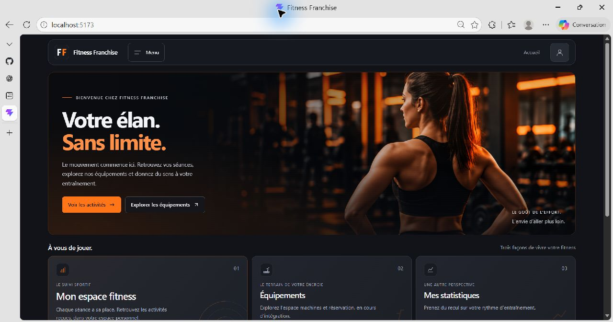

L'utilisateur retrouve la bannière, le bouton Voir les activités et les accès rapides aux équipements et aux statistiques. Cette capture montre la partie supérieure de la page, avant connexion.

### Figure 2 - Menu principal

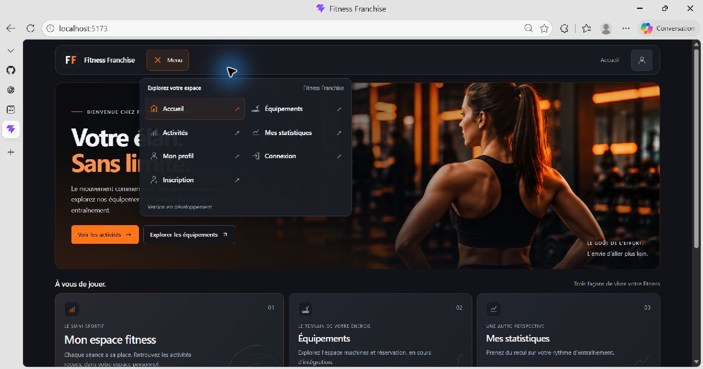

Le bouton Menu ouvre les sept destinations de l'application. Le menu se ferme après le choix d'une page. L'icône de compte donne accès au profil ou à la connexion selon la session.

## 12. Parcours illustré - créer un compte et se connecter

### Figure 3 - Inscription

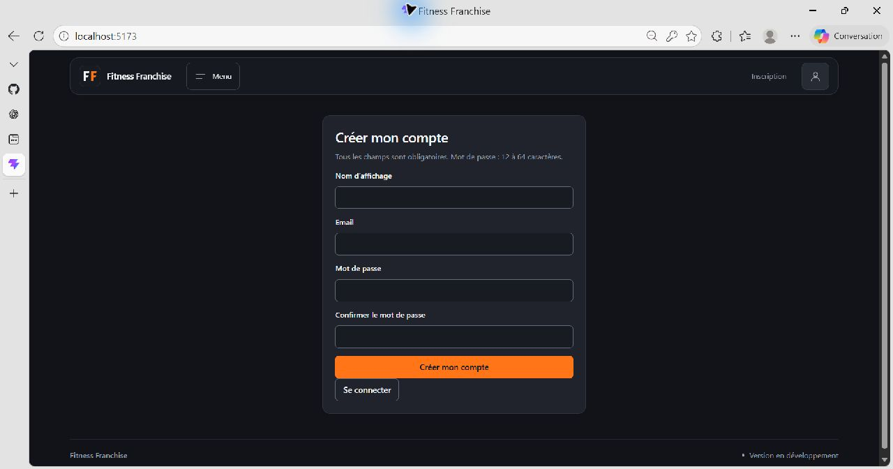

Le formulaire demande le nom d'affichage, l'email, le mot de passe et sa confirmation. Créer mon compte soumet la demande au backend ; le bouton Se connecter permet ensuite d'ouvrir une session. Aucun âge ni genre n'est demandé.

### Figure 4 - Connexion

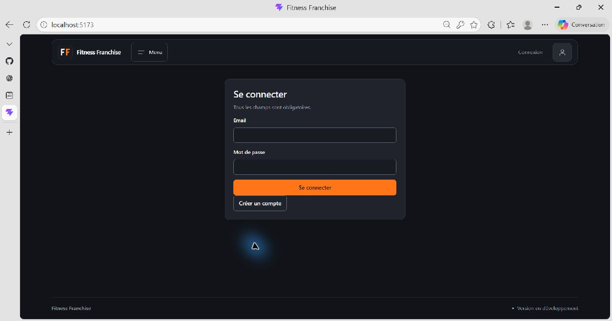

L'utilisateur saisit son email et son mot de passe, puis choisit Se connecter. Créer un compte renvoie à l'inscription. Les identifiants incorrects sont refusés sans révéler si l'email existe.

## 13. Parcours illustré - profil et historique personnel

### Figure 5 - Profil connecté

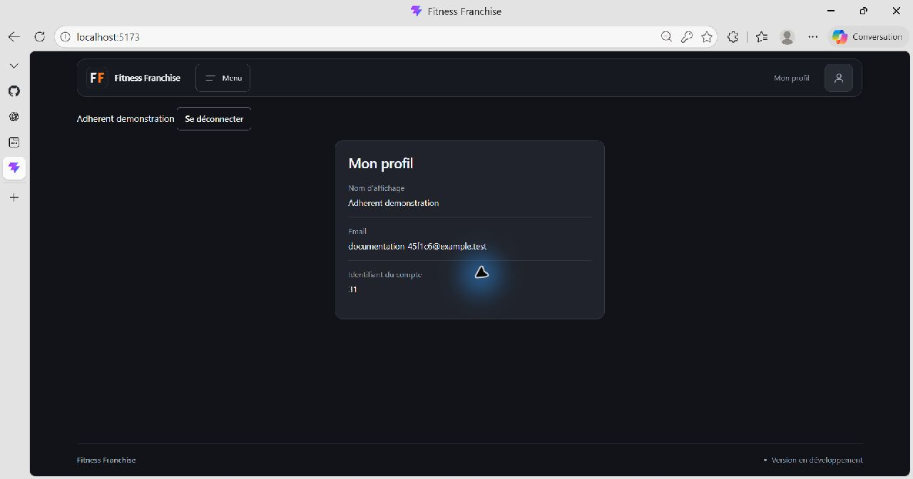

La session du compte fictif affiche son nom, son email et son identifiant. Le bouton Se déconnecter termine la session. Les valeurs de cette capture sont exclusivement des données de démonstration.

### Figure 6 - Historique, filtres et résumé

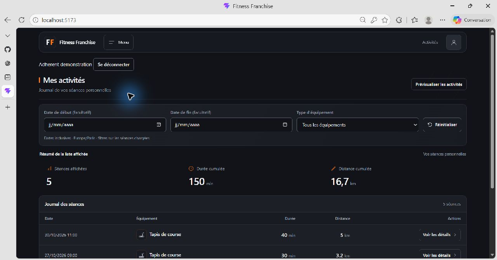

L'utilisateur filtre par date de début, date de fin ou type d'équipement. Le résumé porte sur les séances affichées : ici cinq séances, 150 minutes et 16,7 km. Réinitialiser retire les filtres.

## 14. Parcours illustré - journal et détail d'une séance

### Figure 7 - Fenêtre de détail

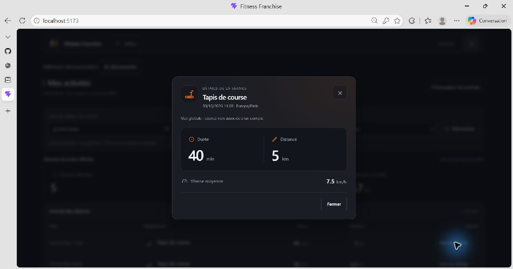

Voir les détails ouvre une fenêtre présentant la date, la durée, la distance et la vitesse moyenne calculée. Exemple : 40 minutes, 5 km, soit 7,5 km/h. Le texte « Vue globale » est un ancien libellé à corriger, conservé dans cette capture fidèle de l'interface.

### Figure 8 - Journal des cinq séances

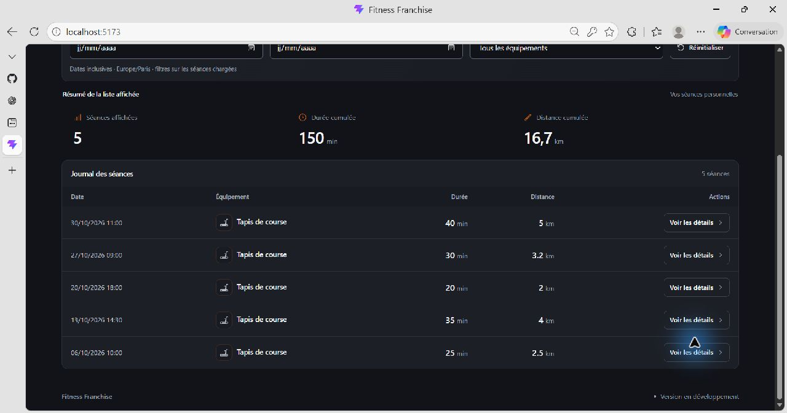

Après défilement, le tableau présente les cinq séances du compte fictif dans l'ordre décroissant. Chaque ligne dispose de son action Voir les détails. Le total de la liste reste visible au-dessus du journal.

## 15. Parcours illustré - statistiques et graphique

### Figure 9 - Filtres et trois indicateurs

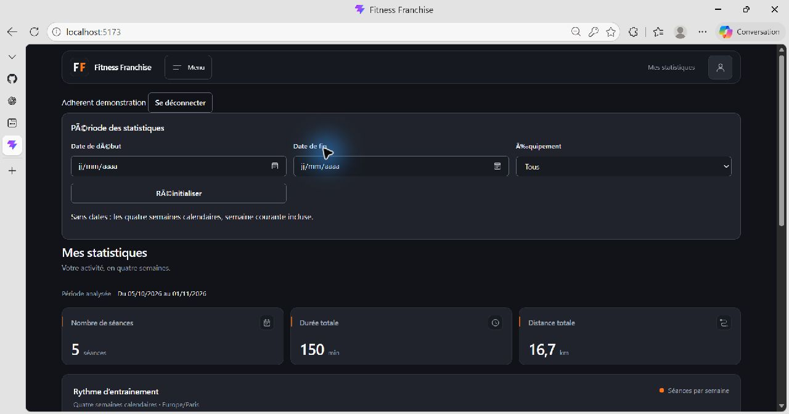

L'utilisateur choisit une période et un équipement. Les cartes affichent les résultats de l'API pour cette période. Des accents mal affichés sont visibles dans les libellés des filtres ; ils restent à corriger lors de la révision de l'interface.

### Figure 10 - Évolution sur quatre semaines

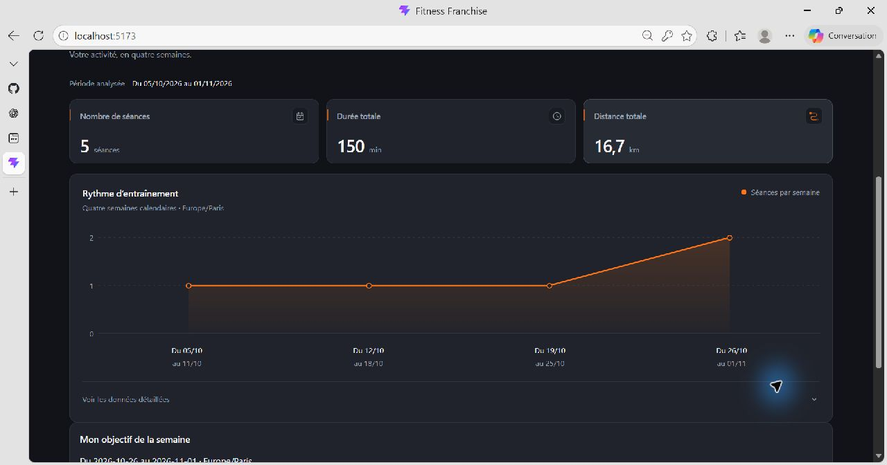

Le graphique compte une, une, une puis deux séances entre le 5 octobre et le 1er novembre. Les trois cartes et les semaines correspondent au même jeu de données. Voir les données détaillées permet une lecture textuelle des valeurs.

## 16. Parcours illustré - progression de l'objectif

### Figure 11 - Objectif en cours

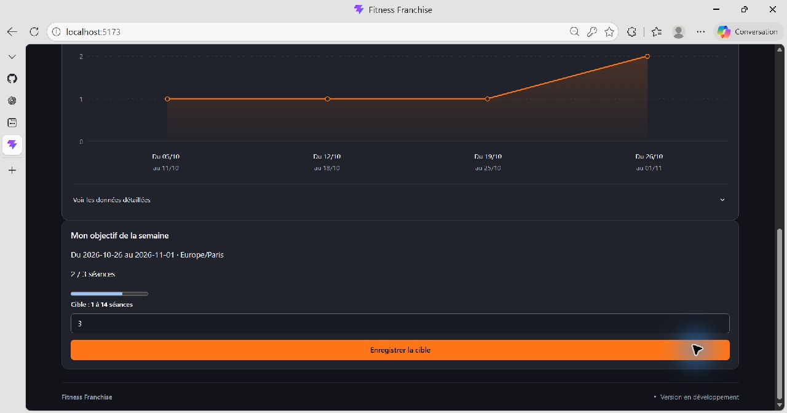

Le compte fictif a réalisé deux séances sur une cible de trois dans la semaine du 26 octobre. Le champ Cible permet de saisir un entier entre 1 et 14 ; Enregistrer la cible persiste la modification pour cette semaine.

### Figure 12 - Objectif atteint

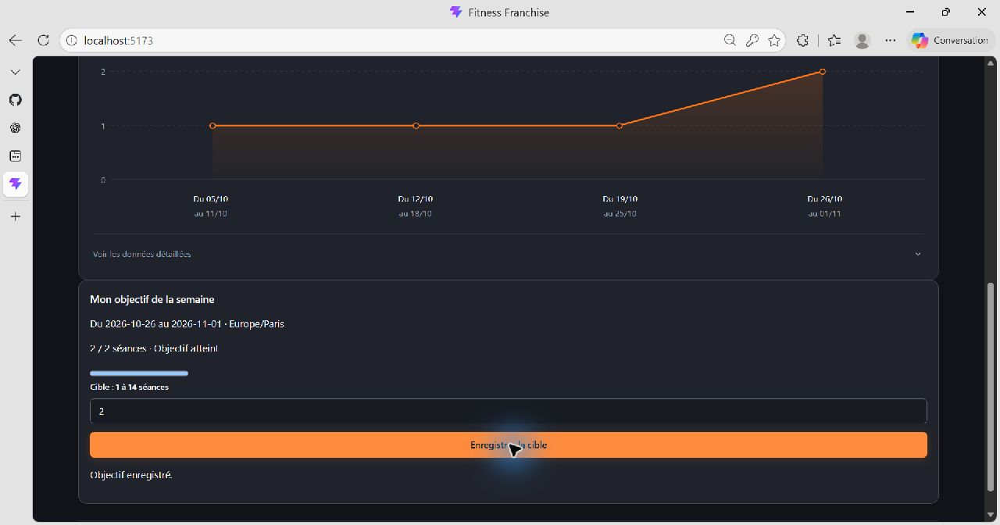

Après modification de la cible à deux, la page affiche 2 / 2 séances, Objectif atteint et Objectif enregistré. La barre est remplie à 100 %. Ce changement concerne uniquement le compte fictif de documentation.

## 17. Parcours illustré - équipements et démonstration

### Figure 13 - État du catalogue réel

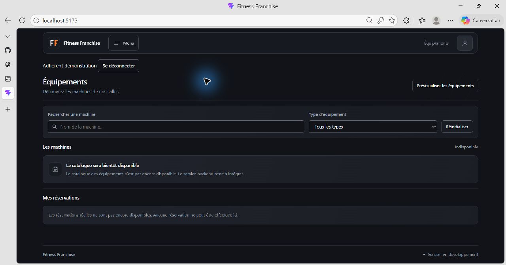

La page affiche la recherche, le filtre de type et l'état du service. Le catalogue et les réservations réelles ne sont pas encore raccordés. Le bouton Prévisualiser les équipements ouvre un aperçu de présentation.

### Figure 14 - Catalogue fictif

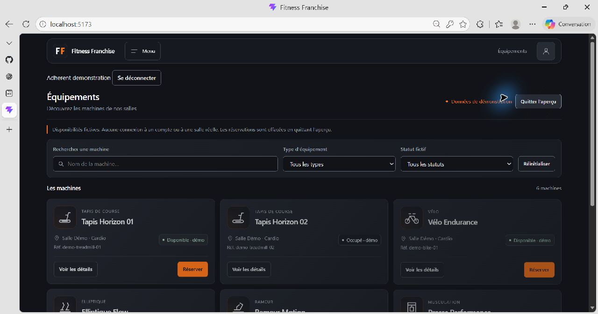

L'aperçu montre six machines avec des statuts fictifs et des actions de détail ou de réservation locale. Le bandeau Données de démonstration précise la nature de cet écran. Ces cartes ne représentent pas les disponibilités réelles d'une salle.

## 18. Parcours illustré - fiche machine et fenêtre étroite

### Figure 15 - Fiche d'un équipement fictif

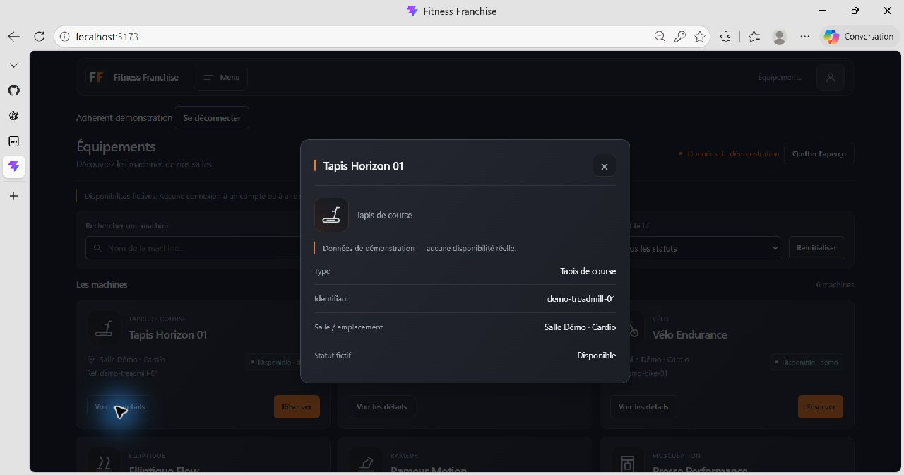

La fenêtre présente le type, l'identifiant de démonstration, l'emplacement et le statut fictif de Tapis Horizon 01. Le bouton de fermeture ramène au catalogue. Aucune disponibilité réelle n'est revendiquée.

### Figure 16 - Accueil dans une fenêtre étroite

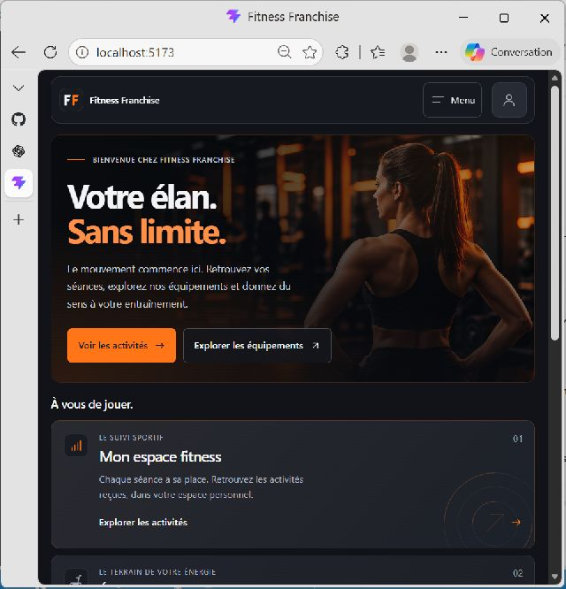

Cette vue de 640 pixels de large montre l'adaptation de la bannière et l'empilement des accès rapides. Il s'agit d'une fenêtre de navigateur réduite, et non d'une capture de téléphone. La recette mobile et clavier complète reste à consigner par l'équipe.
